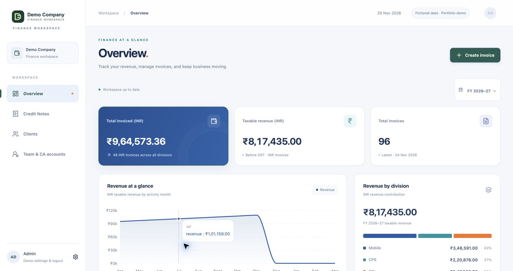

<div align="center">

# Demo Company — Finance Workspace

### A multi-role finance operations system with deterministic accounting workflows

[](https://react.dev/)
[](https://www.typescriptlang.org/)
[](https://vite.dev/)
[](https://vitest.dev/)
[](https://digitalmediamarketingfinancedashboa.vercel.app/)

[Live Finance Workspace](https://digitalmediamarketingfinancedashboa.vercel.app/) · [Source Code](https://github.com/adityajaiswal1724/digitalmediamarketing_finance_dashboard)

</div>

A functional portfolio application for exploring the day-to-day work of a finance administrator, employee and Chartered Accountant. Create campaign invoices, apply credit notes, track payments, review financial periods and download sample documents from a single responsive workspace.

**All business records, contact details, tax identifiers, payment details and branding are fictional.** Generated PDFs are marked as sample documents and cannot be used for payment or tax filing.



## Engineering highlights

- A shared Decimal.js calculation layer keeps form previews, saved records, reports, exports and PDFs mathematically consistent.
- Domain invariants protect invoice chronology, edit windows, cumulative credits, exact tax reversal and outstanding balances.
- Role-aware Admin, Employee and CA workspaces demonstrate guarded navigation and reversible account switching.
- Deterministic rolling fixtures model three Indian financial years, seven currencies and linked invoices, credits and payments.
- CSV formula-injection escaping, sample-labelled PDFs and explicit demo boundaries reduce misuse risk.
- Vitest coverage exercises financial rules, access control, reporting periods, seed relationships and document generation.

## System architecture

```text
Role-aware React interface
          │
          ▼
Workflow and domain services ───► access · invoices · credits · payments
          │
          ▼
Shared Decimal.js finance core ─► GST · currency · balance invariants
          │
     ┌────┴───────────────┐
     ▼                    ▼
localStorage state     PDF / CSV exports
     │                    │
     └─────────► static Vite deployment on Vercel
```

## Explore the demo

Choose a portal on the landing page and select **Explore demo** for one-click access. Manual sign-in is also available:

| Portal | Username | Public demo password | Access |
| --- | --- | --- | --- |
| Admin | `admin` | `admin@1234` | Clients, accounts, invoices, credits, payments and reports |
| Employee — CPS | `emp1` | `emp@1234` | CPS invoicing and personal history |
| Employee — CPL | `emp2` | `emp@1234` | CPL invoicing and personal history |
| Employee — Mobile | `emp3` | `emp@1234` | Mobile invoicing and personal history |
| CA | `ca1` | `ca@1234` | Read-only histories, PDFs and combined accounting CSV |

Suggested walkthrough:

1. Enter Admin and dismiss the brief introduction with **I Understand**.
2. Compare financial years on the dashboard, then filter invoice history by month, dates, division or seller registration.
3. Create an invoice for a demo client, add campaign units and rates, and preview the calculated GST and PDF.
4. Create a percentage, fixed-base or remaining-balance credit note against that invoice. Compare both documents side by side.
5. Record a partial payment and inspect the resulting balance.
6. Open **Team & CA accounts → Login As** to explore an employee or CA workspace, then return to Admin.
7. In CA, choose a financial year/month and export both document histories in one CSV.

Each major page has a six-point guide. Admin’s profile button opens **Demo settings**, including a confirmed reset to restore the sample dataset.

## Features

- Admin, department-specific Employee and read-only CA portals, with route guards and reversible Admin account switching.
- Client profiles for Indian and international businesses; editable fictional GST/PAN identifiers and country-specific fields.
- Employee and CA account creation, editing and activation controls.
- Multiple campaigns, currency selection, Indian exchange-rate inputs and two fictional seller registrations.
- Decimal arithmetic shared between form previews, reports and PDFs, including currency-aware rounding.
- Globally enforced new-invoice chronology and fixed edit deadlines through the fifth of the following month.
- Percentage credits, fixed-base credits and full reversals of remaining balances, with cumulative-credit validation.
- Saved invoice snapshots on credit notes; protected edits prevent reducing invoices below already credited amounts.
- Partial and full payments, credits and remaining balances displayed in the invoice’s own currency.
- Financial-year, month, date-range, search, division and GST-state filters; pagination; CSV exports with formula-injection escaping.
- Multi-page invoice and credit-note PDFs with fictional payment details, sample labels, embedded fonts and repeated page headers.
- Responsive layouts, accessible dialogs, contextual empty states and a browser-local reset.

## Sample data

The deterministic seed creates **12 clients**, **3 employees**, **1 CA account**, and monthly invoices spanning **two completed Indian financial years plus the current year to date**. The year runs from April to March. In the current seed window, the dataset contains **384 invoices and 96 linked credit notes**, covering FY 2024–25, 2025–26 and 2026–27.

It includes seven currencies (INR, USD, GBP, EUR, JPY, SGD and AED), local and interstate GST, multiple campaigns, Admin- and Employee-created records, partial/full/unpaid balances, different credit modes and credit dates that can cross reporting periods. Nothing is seeded after the current date. Newly seeded date ranges advance with time; an existing browser retains its saved dataset until reset.

## Architecture and demo boundaries

This is a **browser-local single-page application**, deployed as static assets. React state drives interactions; `localStorage` persists records and `sessionStorage` retains the current demo login and Admin return state. Visitors have independent data in their own browser. Reloading preserves edits; clearing browser storage or resetting restores defaults.

The application intentionally has **no backend, database, production API connection, email delivery, password recovery, server audit history or secure multi-user authentication**. Public passwords and client-side role guards demonstrate the workflow; they do not protect sensitive information. Do not enter real client data or reuse a personal password. Concurrent edits across tabs/devices are not synchronized.

All essential portfolio workflows operate locally. A production system would require server authorization, database transactions, immutable audit events, secure credentials, validated tax policies, backups and durable document storage. The production source’s API/configuration, database exports and private assets are not part of this project; its relevant UI and calculation workflows have been adapted to this isolated demo.

### Calculation policy

- Base amount: round each `units × rate × optional Indian exchange rate` in the invoice currency, then sum.
- Indian invoices: matching seller/client states apply 9% CGST plus 9% SGST; different states apply 18% IGST.
- International invoices: zero GST for demonstration, with the selected currency retained and no automatic FX conversion.
- Credits: proportional taxes, cumulative caps and exact remaining-tax reversal avoid double-crediting.
- Balance: invoice total minus applicable demo deduction, credit totals and cumulative payments received. Overpayments appear as a negative balance requiring a manual refund/adjustment; no funds are transferred.
- The inherited deduction helper supports classification examples; clearly invalid sample GST identifiers intentionally do not simulate valid legal registrations and default to zero deduction.
- Dashboard monetary cards/charts use INR only; histories and CSV rows retain currency codes. Credit status is the editable/locked document state; there is no approval workflow.

These are illustrative application rules, not tax advice or statutory reporting software.

### Code layout

```text
src/
  App.tsx                 Role routing, state and workflow coordination
  access.ts               Demo accounts and access helpers
  demo-data.ts            Rolling fictional dataset
  demo-state.ts           Credit reconciliation and edit invariants
  model.ts                Invoices, clients, periods and totals
  credit-notes.ts         Allocation, reversal and validation
  pdf.ts                  Sample invoice / credit PDF rendering
  features/               Auth, clients, employees, invoices, credits, accounting
  components/             Branding, guides and accessible UI primitives
packages/finance/          Shared Decimal.js calculation library
public/                    Fictional SVG branding and licensed embedded fonts
```

## Run locally

Use Node.js 22.12+ (Node 24 LTS recommended) and npm.

```sh
npm ci
npm run dev
```

Open [http://127.0.0.1:5173](http://127.0.0.1:5173). No environment variables, credentials or services are required.

```sh
npm test
npm run build
npm run preview
```

Tests cover amounts, rounding, state-specific taxes, access, date rules, credit allocation, reporting periods, CSV escaping, seed relationships and PDF generation. PDF tests write review artifacts to ignored `output/pdf/`. Production assets are written to ignored `dist/`.

## Publish on GitHub and Vercel

The production demo is live at [digitalmediamarketingfinancedashboa.vercel.app](https://digitalmediamarketingfinancedashboa.vercel.app/).

Upload this project’s source, `packages/`, `public/`, package lock, README and configuration. The supplied `.gitignore` excludes dependencies, generated output, local environment files, caches and deployment state. No live credentials or database exports are needed.

In Vercel, import the GitHub repository with these settings:

| Setting | Value |
| --- | --- |
| Root directory | This project’s root |
| Framework | Vite |
| Install | `npm ci` |
| Build | `npm run build` |
| Output | `dist` |
| Node.js | 24.x |
| Environment variables | None |

`vercel.json` supplies the Vite build settings and SPA fallback so direct links such as `/clients` and `/ca/invoices` load correctly. This follows [Vercel’s Vite SPA deployment guidance](https://vercel.com/docs/frameworks/frontend/vite#using-vite-to-make-spas). After deployment, open a deep link and test each portal on the preview URL before adding it to a portfolio.

Running the application locally does not modify the GitHub repository or the Vercel deployment.

## Stack and credits

React 19 · TypeScript · Vite · React Router · Tailwind CSS · Radix UI · Lucide · Recharts · Motion · Decimal.js · jsPDF · jsPDF-AutoTable · Vitest.

The demo logo is an original code-drawn SVG. Carlito fonts are bundled under the SIL Open Font License; see `public/fonts/OFL.txt`. Open-source dependencies retain their respective licenses.

## Builder profile

Built by [Aditya Jaiswal](https://github.com/adityajaiswal1724), a Full-Stack Developer and AI/ML & Automation Engineer. This project demonstrates domain-driven frontend engineering, financial rule modelling, deterministic data, document generation, accessibility and testable business workflows.

---

<div align="center">
Designed as a rigorous portfolio case study, not production accounting or tax software.
</div>
